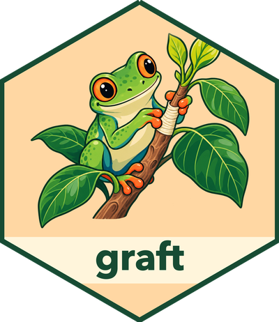

# graft 

<!-- badges: start -->
[](https://github.com/JamesHWade/graft/actions/workflows/R-CMD-check.yaml)
[](https://app.codecov.io/gh/JamesHWade/graft)
[](https://lifecycle.r-lib.org/articles/stages.html#experimental)
<!-- badges: end -->

**Persistent, reviewed memory and artifacts for R apps and agents.**

Chat sessions reset when the window closes, and vector search returns whatever
matches—drafts and outdated notes included. `graft` adds a review-gated memory
store to your [ellmer](https://ellmer.tidyverse.org/),
[shinychat](https://posit-dev.github.io/shinychat/),
[deputy](https://jameshwade.github.io/deputy/), or
[mcptools](https://posit-dev.github.io/mcptools/) workflow: save outputs with
their source evidence, record explicit accept/withdraw decisions from your app,
and give models bounded, read-only recall.

## Installation

```r
# install.packages("pak")
pak::pak("JamesHWade/graft")
```

## Wire graft into an app or agent

```r
library(graft)

store <- graft_store("project-memory", create = TRUE)

# Your app saves evidence and records explicit human review:
source_ref <- graft_save(store, "Handbook: use a 30-day activity window.", "metrics.md")
note_ref <- graft_save(
  store,
  "An active customer has a paid account and activity in the past 30 days.",
  id = "metric:active-customer",
  dependencies = source_ref
)
graft_accept(
  store,
  note_ref,
  stream = "metric:active-customer",
  expected = NULL,
  key = "review-1",
  actor = "analyst",
  reason = "Matches the metrics handbook",
  purpose = "project-assistance"
)

# Register bounded, read-only recall on an ellmer chat, deputy agent, or MCP server:
chat <- ellmer::chat_openai()
chat$set_tools(graft_tools(
  store,
  purpose = "project-assistance",
  eligible = function(stream) TRUE
))
```

Saving a correction under the same ID creates a new immutable revision. Earlier
revisions remain readable by exact reference with `graft_read()`, while
`graft_recall()` and `graft_tools()` check current acceptance, purpose, and
fresh host eligibility on every call.

## Copy a working Shiny template

The package includes a minimal Shiny + `shinychat` starter app
([inst/examples/project-memory/](inst/examples/project-memory/)) with review
controls, session reset on correction, and persistent local storage. It runs
with scripted replies by default, or set `OPENAI_API_KEY` and
`Sys.setenv(GRAFT_DEMO_LIVE = "true")` for a live `ellmer` agent:

```r
pak::pak(c("JamesHWade/graft", "ellmer", "shinychat", "shiny", "bslib"))
Sys.setenv(GRAFT_DEMO_STORE = file.path(getwd(), "project-memory"))
shiny::runApp(system.file("examples", "project-memory", package = "graft"))
```

## How graft fits in the ellmer ecosystem

| Package | What it owns | How it pairs with graft |
|---|---|---|
| **ellmer** & **shinychat** | Model calls, tools, and chat UI | Register `graft_tool()` or `graft_tools()` so chats consult reviewed memory with tool cards |
| **ragnar** | Similarity search (RAG) | **ragnar finds, graft verifies**: search broadly with ragnar, recall only accepted revisions via `graft_recall()` |
| **commons** & **data-dict** | Trusted data analysis & data contracts | Commons runs live queries; graft preserves reviewed outputs and pinned shared vocabularies |
| **deputy** | Governed agent runtime & `TrustedResults` | Run graft tools in read-only/plan modes and capture agent drafts for human review |
| **mcptools** | Model Context Protocol | Serve `graft_tool()` or `graft_tools()` to Claude Code, Positron, or Posit Assistant |
| **vitals** & **scans** | LLM evals & trajectory analysis | Score recall accuracy with `vitals`; inspect `@extra$graft` consultations and promote findings from `scans` |

## Documentation

- [Add reviewed memory to an app](https://jameshwade.github.io/graft/articles/getting-started.html) — `ellmer`, `shinychat`, `deputy`, `mcptools`, and `ragnar` integration guide
- [Integrate with the ellmer ecosystem](https://jameshwade.github.io/graft/articles/architecture.html) — architecture diagram, ownership boundaries, and `scans` loop
- [Persist artifacts and PostgreSQL scopes](https://jameshwade.github.io/graft/articles/persistent-artifacts.html) — selections, decision streams, local locks, and PostgreSQL scopes
- [Evaluate recall with vitals and scans](https://jameshwade.github.io/graft/articles/recall-evaluation.html) — offline `vitals::Task` for memory recall
- [Share vocabulary across data-dict workflows](https://jameshwade.github.io/graft/articles/shared-vocabulary.html) — publish and reuse pinned `data-dict` vocabularies

## Scope and storage

Local stores use trusted files on disk with per-stream advisory file locks for
multi-process Shiny deployments (requires a file system that honors advisory
locks). For multi-user isolation or transactional databases,
`graft_store_postgres()` persists artifacts inside a host-owned PostgreSQL
transaction isolated by a host-selected scope key. In both cases, your
application owns authentication, authorization, and approval policy.
